<!-- Generated by github.com/trick77/ship/kit/schemadoc, do not edit. Regenerate in the Go module directory: SCHEMADOC_UPDATE=1 go test ./... -run TestSchemaDoc -->

# Database schema

30 tables, 33 continuous aggregates; the diagram is at the end. Go types are the `model.go` structs whose rows they hold.

## agent_samples

| Column | Type | Null | Default | PK |
| --- | --- | --- | --- | --- |
| `host_id` | integer | no |  | 1 |
| `ts` | timestamp with time zone | no |  | 2 |
| `uptime_s` | bigint | yes |  |  |
| `rss_bytes` | bigint | yes |  |  |
| `goroutines` | integer | yes |  |  |
| `scrape_duration_ms` | integer | yes |  |  |
| `buffer_depth` | integer | yes |  |  |
| `buffer_dropped_total` | bigint | yes |  |  |
| `post_failures_total` | bigint | yes |  |  |
| `post_latency_ms` | integer | yes |  |  |
| `hub_connect_us` | integer | yes |  |  |
| `hub_connect_max_us` | integer | yes |  |  |
| `hub_connect_failures_total` | bigint | yes |  |  |

Foreign keys:

- `host_id` → `hosts` (`id`), on delete CASCADE

Indexes:

- `agent_samples_ts_idx` (`ts`)

## collector_samples

| Column | Type | Null | Default | PK |
| --- | --- | --- | --- | --- |
| `host_id` | integer | no |  | 1 |
| `ts` | timestamp with time zone | no |  | 2 |
| `collector` | text | no |  | 3 |
| `duration_ms` | integer | yes |  |  |
| `ok` | boolean | no |  |  |
| `error_code` | text | yes |  |  |

Foreign keys:

- `host_id` → `hosts` (`id`), on delete CASCADE

Indexes:

- `collector_samples_ts_idx` (`ts`)

## container_samples

| Column | Type | Null | Default | PK |
| --- | --- | --- | --- | --- |
| `host_id` | integer | no |  | 1 |
| `ts` | timestamp with time zone | no |  | 2 |
| `container_id` | integer | no |  | 3 |
| `cpu_pct` | double precision | yes |  |  |
| `mem_used` | bigint | yes |  |  |
| `mem_limit` | bigint | yes |  |  |
| `net_rx` | double precision | yes |  |  |
| `net_tx` | double precision | yes |  |  |
| `io_read` | double precision | yes |  |  |
| `io_write` | double precision | yes |  |  |
| `cpu_user` | double precision | yes |  |  |
| `cpu_system` | double precision | yes |  |  |
| `mem_anon` | bigint | yes |  |  |
| `mem_file` | bigint | yes |  |  |
| `mem_shmem` | bigint | yes |  |  |
| `mem_kernel` | bigint | yes |  |  |
| `restart_count` | bigint | yes |  |  |

Foreign keys:

- `container_id`, `host_id` → `containers` (`id`, `host_id`), on delete CASCADE
- `host_id` → `hosts` (`id`), on delete CASCADE

Indexes:

- `container_samples_container_id_host_id_idx` (`container_id`, `host_id`)
- `container_samples_ts_idx` (`ts`)

## containers

Go types:

- `read.Container` (internal/hub/read): Container is one row of /hosts/{id}/containers.
- `store.containerState` (internal/hub/store): containerState is what the hub already knows about a container: the values stored on its row before this batch is applied.

| Column | Type | Null | Default | PK |
| --- | --- | --- | --- | --- |
| `id` | integer | no | `identity always` | 1 |
| `host_id` | integer | no |  |  |
| `container_key` | text | no |  |  |
| `name` | text | yes |  |  |
| `image` | text | yes |  |  |
| `is_agent` | boolean | no | `false` |  |
| `first_seen` | timestamp with time zone | no | `now()` |  |
| `last_seen` | timestamp with time zone | no | `now()` |  |
| `docker_state` | text | yes |  |  |
| `health` | text | yes |  |  |
| `state_ts` | timestamp with time zone | yes |  |  |
| `labels` | jsonb | yes |  |  |
| `restart_count` | bigint | yes |  |  |
| `started_at` | timestamp with time zone | yes |  |  |

Foreign keys:

- `host_id` → `hosts` (`id`), on delete CASCADE

Indexes:

- `containers_host_id_container_key_key` (`host_id`, `container_key`) unique
- `containers_id_host_id_key` (`id`, `host_id`) unique
- `containers_seen_idx` (`last_seen`, `first_seen`)

## cpu_core_samples

| Column | Type | Null | Default | PK |
| --- | --- | --- | --- | --- |
| `host_id` | integer | no |  | 1 |
| `ts` | timestamp with time zone | no |  | 2 |
| `core` | integer | no |  | 3 |
| `busy` | double precision | yes |  |  |

Foreign keys:

- `host_id` → `hosts` (`id`), on delete CASCADE

Indexes:

- `cpu_core_samples_ts_idx` (`ts`)

## devices

| Column | Type | Null | Default | PK |
| --- | --- | --- | --- | --- |
| `id` | integer | no | `identity always` | 1 |
| `host_id` | integer | no |  |  |
| `device` | text | no |  |  |
| `model` | text | yes |  |  |
| `serial` | text | yes |  |  |
| `first_seen` | timestamp with time zone | no | `now()` |  |
| `last_seen` | timestamp with time zone | no | `now()` |  |
| `size_bytes` | bigint | yes |  |  |

Foreign keys:

- `host_id` → `hosts` (`id`), on delete CASCADE

Indexes:

- `devices_host_id_device_key` (`host_id`, `device`) unique
- `devices_id_host_id_key` (`id`, `host_id`) unique
- `devices_seen_idx` (`last_seen`, `first_seen`)

## disk_io_samples

| Column | Type | Null | Default | PK |
| --- | --- | --- | --- | --- |
| `host_id` | integer | no |  | 1 |
| `ts` | timestamp with time zone | no |  | 2 |
| `device` | text | no |  | 3 |
| `read_bytes` | double precision | yes |  |  |
| `write_bytes` | double precision | yes |  |  |
| `read_ops` | double precision | yes |  |  |
| `write_ops` | double precision | yes |  |  |
| `io_util_pct` | double precision | yes |  |  |
| `r_await_ms` | double precision | yes |  |  |
| `w_await_ms` | double precision | yes |  |  |
| `weighted_io_pct` | double precision | yes |  |  |

Foreign keys:

- `host_id` → `hosts` (`id`), on delete CASCADE

Indexes:

- `disk_io_samples_ts_idx` (`ts`)

## events

| Column | Type | Null | Default | PK |
| --- | --- | --- | --- | --- |
| `id` | integer | no | `identity always` | 1 |
| `host_id` | integer | no |  |  |
| `ts` | timestamp with time zone | no |  |  |
| `type` | text | no |  |  |
| `subject` | text | yes |  |  |
| `detail` | jsonb | no | `'{}'::jsonb` |  |
| `severity` | text | no | `'info'::text` |  |

Foreign keys:

- `host_id` → `hosts` (`id`), on delete CASCADE

Indexes:

- `events_host_id_ts_idx` (`host_id`, `ts`)
- `events_host_id_ts_type_subject_key` (`host_id`, `ts`, `type`, `subject`) unique
- `events_host_type_subject_ts_idx` (`host_id`, `type`, `subject`, `ts`)
- `events_notable_ts_idx` (`ts`) where `severity <> 'info'::text`

Checks:

- `CONSTRAINT events_severity_check CHECK (severity = ANY (ARRAY['info'::text, 'warning'::text, 'critical'::text]))`

## filesystem_current

| Column | Type | Null | Default | PK |
| --- | --- | --- | --- | --- |
| `host_id` | integer | no |  | 1 |
| `fs_id` | integer | no |  | 2 |
| `ts` | timestamp with time zone | no |  |  |
| `total` | bigint | yes |  |  |
| `used` | bigint | yes |  |  |
| `free` | bigint | yes |  |  |

Foreign keys:

- `fs_id`, `host_id` → `filesystems` (`id`, `host_id`), on delete CASCADE
- `host_id` → `hosts` (`id`), on delete CASCADE

## filesystem_samples

| Column | Type | Null | Default | PK |
| --- | --- | --- | --- | --- |
| `host_id` | integer | no |  | 1 |
| `ts` | timestamp with time zone | no |  | 2 |
| `fs_id` | integer | no |  | 3 |
| `total` | bigint | yes |  |  |
| `used` | bigint | yes |  |  |
| `free` | bigint | yes |  |  |
| `inodes_total` | bigint | yes |  |  |
| `inodes_used` | bigint | yes |  |  |
| `read_bytes` | double precision | yes |  |  |
| `write_bytes` | double precision | yes |  |  |

Foreign keys:

- `fs_id`, `host_id` → `filesystems` (`id`, `host_id`), on delete CASCADE
- `host_id` → `hosts` (`id`), on delete CASCADE

Indexes:

- `filesystem_samples_fs_id_host_id_idx` (`fs_id`, `host_id`)
- `filesystem_samples_ts_idx` (`ts`)

## filesystems

Go types:

- `read.Filesystem` (internal/hub/read): Filesystem is one row of /hosts/{id}/filesystems, and the same shape the host list embeds per host.

| Column | Type | Null | Default | PK |
| --- | --- | --- | --- | --- |
| `id` | integer | no | `identity always` | 1 |
| `host_id` | integer | no |  |  |
| `label` | text | no |  |  |
| `mountpoint` | text | yes |  |  |
| `device_id` | bigint | yes |  |  |

Foreign keys:

- `host_id` → `hosts` (`id`), on delete CASCADE

Indexes:

- `filesystems_host_id_label_key` (`host_id`, `label`) unique
- `filesystems_id_host_id_key` (`id`, `host_id`) unique

## host_addresses

Go types:

- `read.Address` (internal/hub/read): Address is one row of /hosts/{id}/addresses.

| Column | Type | Null | Default | PK |
| --- | --- | --- | --- | --- |
| `host_id` | integer | no |  | 1 |
| `iface` | text | no |  | 2 |
| `if_index` | integer | yes |  |  |
| `address` | inet | no |  | 3 |
| `family` | smallint | no |  |  |
| `scope` | text | yes |  |  |
| `vrf` | text | yes |  |  |
| `description` | text | yes |  |  |
| `first_seen` | timestamp with time zone | no | `now()` |  |
| `last_seen` | timestamp with time zone | no | `now()` |  |

Foreign keys:

- `host_id` → `hosts` (`id`), on delete CASCADE

## host_conditions

Go types:

- `conditions.Key` (internal/hub/conditions): Key identifies one condition: a kind, about one subject, on one host.
- `conditions.Open` (internal/hub/conditions): Open is a condition currently recorded as open, as read back from the store.
- `read.Condition` (internal/hub/read): Condition is one open condition, as the fleet page reads it.

| Column | Type | Null | Default | PK |
| --- | --- | --- | --- | --- |
| `id` | integer | no | `identity always` | 1 |
| `host_id` | integer | no |  |  |
| `kind` | text | no |  |  |
| `subject` | text | no | `''::text` |  |
| `severity` | text | no |  |  |
| `opened_ts` | timestamp with time zone | no |  |  |
| `opened_at_least` | boolean | no | `false` |  |
| `resolved_ts` | timestamp with time zone | yes |  |  |
| `resolved_reason` | text | yes |  |  |
| `missing_ticks` | integer | no | `0` |  |
| `detail` | jsonb | no | `'{}'::jsonb` |  |

Foreign keys:

- `host_id` → `hosts` (`id`), on delete CASCADE

Indexes:

- `host_conditions_host_opened_idx` (`host_id`, `opened_ts`)
- `host_conditions_open_key` (`host_id`, `kind`, `subject`) unique where `resolved_ts IS NULL`

Checks:

- `CONSTRAINT host_conditions_resolution_complete CHECK ((resolved_ts IS NULL) = (resolved_reason IS NULL))`
- `CONSTRAINT host_conditions_resolved_reason_check CHECK (resolved_reason = ANY (ARRAY['cleared'::text, 'vanished'::text]))`
- `CONSTRAINT host_conditions_severity_check CHECK (severity = ANY (ARRAY['warning'::text, 'critical'::text]))`

## host_current

| Column | Type | Null | Default | PK |
| --- | --- | --- | --- | --- |
| `host_id` | integer | no |  | 1 |
| `last_seen` | timestamp with time zone | yes |  |  |
| `cpu_total` | double precision | yes |  |  |
| `mem_used` | bigint | yes |  |  |
| `mem_total` | bigint | yes |  |  |
| `uptime_s` | bigint | yes |  |  |
| `net_rx_bytes` | double precision | yes |  |  |
| `net_tx_bytes` | double precision | yes |  |  |
| `services_total` | integer | yes |  |  |
| `services_failed` | integer | yes |  |  |
| `received_at` | timestamp with time zone | no | `now()` |  |

Foreign keys:

- `host_id` → `hosts` (`id`), on delete CASCADE

## host_interfaces

Go types:

- `read.Interface` (internal/hub/read): Interface is one row of /hosts/{id}/interfaces: one link, with no addresses on it.

| Column | Type | Null | Default | PK |
| --- | --- | --- | --- | --- |
| `host_id` | integer | no |  | 1 |
| `iface` | text | no |  | 2 |
| `if_index` | integer | yes |  |  |
| `oper_state` | text | yes |  |  |
| `speed_mbps` | bigint | yes |  |  |
| `duplex` | text | yes |  |  |
| `mtu` | integer | yes |  |  |
| `mac` | text | yes |  |  |
| `description` | text | yes |  |  |
| `first_seen` | timestamp with time zone | no | `now()` |  |
| `last_seen` | timestamp with time zone | no | `now()` |  |
| `physical` | boolean | yes |  |  |

Foreign keys:

- `host_id` → `hosts` (`id`), on delete CASCADE

## host_packages

Go types:

- `read.Package` (internal/hub/read): Package is one row of /hosts/{id}/packages.

| Column | Type | Null | Default | PK |
| --- | --- | --- | --- | --- |
| `host_id` | integer | no |  | 1 |
| `name` | text | no |  | 2 |
| `version` | text | no |  |  |
| `arch` | text | no | `''::text` | 3 |
| `format` | text | no |  |  |
| `size_bytes` | bigint | yes |  |  |
| `first_seen` | timestamp with time zone | no | `now()` |  |
| `last_seen` | timestamp with time zone | no | `now()` |  |
| `version_changed_at` | timestamp with time zone | no | `now()` |  |

Foreign keys:

- `host_id` → `hosts` (`id`), on delete CASCADE

## host_proto_samples

| Column | Type | Null | Default | PK |
| --- | --- | --- | --- | --- |
| `host_id` | integer | no |  | 1 |
| `ts` | timestamp with time zone | no |  | 2 |
| `tcp_in_segs_per_s` | double precision | yes |  |  |
| `tcp_out_segs_per_s` | double precision | yes |  |  |
| `tcp_estab_resets_per_s` | double precision | yes |  |  |
| `udp_in_datagrams_per_s` | double precision | yes |  |  |
| `udp_out_datagrams_per_s` | double precision | yes |  |  |
| `udp6_in_datagrams_per_s` | double precision | yes |  |  |
| `udp6_out_datagrams_per_s` | double precision | yes |  |  |

Foreign keys:

- `host_id` → `hosts` (`id`), on delete CASCADE

Indexes:

- `host_proto_samples_ts_idx` (`ts`)

## host_samples

| Column | Type | Null | Default | PK |
| --- | --- | --- | --- | --- |
| `host_id` | integer | no |  | 1 |
| `ts` | timestamp with time zone | no |  | 2 |
| `cpu_total` | double precision | yes |  |  |
| `cpu_user` | double precision | yes |  |  |
| `cpu_system` | double precision | yes |  |  |
| `cpu_iowait` | double precision | yes |  |  |
| `cpu_steal` | double precision | yes |  |  |
| `cpu_idle` | double precision | yes |  |  |
| `mem_total` | bigint | yes |  |  |
| `mem_used` | bigint | yes |  |  |
| `mem_available` | bigint | yes |  |  |
| `mem_buffcache` | bigint | yes |  |  |
| `mem_zfs_arc` | bigint | yes |  |  |
| `mem_free` | bigint | yes |  |  |
| `mem_buffers` | bigint | yes |  |  |
| `mem_cached` | bigint | yes |  |  |
| `mem_shared` | bigint | yes |  |  |
| `mem_sreclaimable` | bigint | yes |  |  |
| `swap_total` | bigint | yes |  |  |
| `swap_used` | bigint | yes |  |  |
| `load1` | double precision | yes |  |  |
| `load5` | double precision | yes |  |  |
| `load15` | double precision | yes |  |  |
| `uptime_s` | bigint | yes |  |  |
| `ctxt_per_s` | double precision | yes |  |  |
| `intr_per_s` | double precision | yes |  |  |
| `forks_per_s` | double precision | yes |  |  |
| `procs_running` | integer | yes |  |  |
| `procs_blocked` | integer | yes |  |  |
| `boot_time_s` | bigint | yes |  |  |
| `processes_total` | integer | yes |  |  |
| `users_logged_in` | integer | yes |  |  |
| `services_total` | integer | yes |  |  |
| `services_failed` | integer | yes |  |  |
| `pgmajfault_per_s` | double precision | yes |  |  |
| `pswpin_per_s` | double precision | yes |  |  |
| `pswpout_per_s` | double precision | yes |  |  |
| `oom_kill_total` | bigint | yes |  |  |
| `sockets_used` | integer | yes |  |  |
| `tcp_orphan` | integer | yes |  |  |
| `tcp_tw` | integer | yes |  |  |
| `tcp_alloc` | integer | yes |  |  |
| `fd_used` | bigint | yes |  |  |
| `fd_limit` | bigint | yes |  |  |
| `conntrack_count` | integer | yes |  |  |
| `conntrack_limit` | integer | yes |  |  |
| `tcp_tw_limit` | integer | yes |  |  |
| `tcp_orphan_limit` | integer | yes |  |  |
| `tcp_retrans_segs_per_s` | double precision | yes |  |  |
| `tcp_out_rsts_per_s` | double precision | yes |  |  |
| `tcp_in_errs_per_s` | double precision | yes |  |  |
| `tcp_active_opens_per_s` | double precision | yes |  |  |
| `tcp_passive_opens_per_s` | double precision | yes |  |  |
| `tcp_attempt_fails_per_s` | double precision | yes |  |  |
| `tcp_curr_estab` | integer | yes |  |  |
| `tcp_listen_overflows_per_s` | double precision | yes |  |  |
| `tcp_listen_drops_per_s` | double precision | yes |  |  |
| `udp_in_errors_per_s` | double precision | yes |  |  |
| `udp_rcvbuf_errors_per_s` | double precision | yes |  |  |
| `udp_sndbuf_errors_per_s` | double precision | yes |  |  |
| `udp_no_ports_per_s` | double precision | yes |  |  |
| `ip_reasm_reqds_per_s` | double precision | yes |  |  |
| `ip_reasm_fails_per_s` | double precision | yes |  |  |
| `ip_frag_fails_per_s` | double precision | yes |  |  |
| `ip_frag_creates_per_s` | double precision | yes |  |  |
| `udp6_in_errors_per_s` | double precision | yes |  |  |
| `udp6_rcvbuf_errors_per_s` | double precision | yes |  |  |
| `udp6_sndbuf_errors_per_s` | double precision | yes |  |  |
| `udp6_no_ports_per_s` | double precision | yes |  |  |
| `ip6_reasm_reqds_per_s` | double precision | yes |  |  |
| `ip6_reasm_fails_per_s` | double precision | yes |  |  |
| `ip6_frag_fails_per_s` | double precision | yes |  |  |
| `ip6_frag_creates_per_s` | double precision | yes |  |  |

Foreign keys:

- `host_id` → `hosts` (`id`), on delete CASCADE

Indexes:

- `host_samples_ts_idx` (`ts`)

## host_snmp_samples

| Column | Type | Null | Default | PK |
| --- | --- | --- | --- | --- |
| `host_id` | integer | no |  | 1 |
| `ts` | timestamp with time zone | no |  | 2 |
| `ip_in_receives_per_s` | double precision | yes |  |  |
| `ip_in_delivers_per_s` | double precision | yes |  |  |
| `ip_out_requests_per_s` | double precision | yes |  |  |
| `ip_forw_datagrams_per_s` | double precision | yes |  |  |
| `ip_reasm_oks_per_s` | double precision | yes |  |  |
| `ip_frag_oks_per_s` | double precision | yes |  |  |
| `ip_in_hdr_errors_per_s` | double precision | yes |  |  |
| `ip_in_addr_errors_per_s` | double precision | yes |  |  |
| `ip_in_unknown_protos_per_s` | double precision | yes |  |  |
| `ip_in_discards_per_s` | double precision | yes |  |  |
| `ip_out_discards_per_s` | double precision | yes |  |  |
| `ip_out_no_routes_per_s` | double precision | yes |  |  |
| `ip_reasm_timeout_per_s` | double precision | yes |  |  |
| `ip6_in_receives_per_s` | double precision | yes |  |  |
| `ip6_in_delivers_per_s` | double precision | yes |  |  |
| `ip6_out_requests_per_s` | double precision | yes |  |  |
| `ip6_out_forw_datagrams_per_s` | double precision | yes |  |  |
| `ip6_reasm_oks_per_s` | double precision | yes |  |  |
| `ip6_frag_oks_per_s` | double precision | yes |  |  |
| `ip6_in_hdr_errors_per_s` | double precision | yes |  |  |
| `ip6_in_addr_errors_per_s` | double precision | yes |  |  |
| `ip6_in_unknown_protos_per_s` | double precision | yes |  |  |
| `ip6_in_discards_per_s` | double precision | yes |  |  |
| `ip6_out_discards_per_s` | double precision | yes |  |  |
| `ip6_out_no_routes_per_s` | double precision | yes |  |  |
| `ip6_in_no_routes_per_s` | double precision | yes |  |  |
| `ip6_in_too_big_errors_per_s` | double precision | yes |  |  |
| `ip6_reasm_timeout_per_s` | double precision | yes |  |  |
| `icmp_in_msgs_per_s` | double precision | yes |  |  |
| `icmp_out_msgs_per_s` | double precision | yes |  |  |
| `icmp_in_errors_per_s` | double precision | yes |  |  |
| `icmp_out_errors_per_s` | double precision | yes |  |  |
| `icmp_in_dest_unreachs_per_s` | double precision | yes |  |  |
| `icmp_out_dest_unreachs_per_s` | double precision | yes |  |  |
| `icmp_in_time_excds_per_s` | double precision | yes |  |  |
| `icmp_out_time_excds_per_s` | double precision | yes |  |  |
| `icmp_in_parm_probs_per_s` | double precision | yes |  |  |
| `icmp_out_parm_probs_per_s` | double precision | yes |  |  |
| `icmp_in_redirects_per_s` | double precision | yes |  |  |
| `icmp_out_redirects_per_s` | double precision | yes |  |  |
| `icmp_in_echos_per_s` | double precision | yes |  |  |
| `icmp_out_echos_per_s` | double precision | yes |  |  |
| `icmp_in_echo_reps_per_s` | double precision | yes |  |  |
| `icmp_out_echo_reps_per_s` | double precision | yes |  |  |
| `icmp6_in_msgs_per_s` | double precision | yes |  |  |
| `icmp6_out_msgs_per_s` | double precision | yes |  |  |
| `icmp6_in_errors_per_s` | double precision | yes |  |  |
| `icmp6_out_errors_per_s` | double precision | yes |  |  |
| `icmp6_in_dest_unreachs_per_s` | double precision | yes |  |  |
| `icmp6_out_dest_unreachs_per_s` | double precision | yes |  |  |
| `icmp6_in_time_excds_per_s` | double precision | yes |  |  |
| `icmp6_out_time_excds_per_s` | double precision | yes |  |  |
| `icmp6_in_parm_problems_per_s` | double precision | yes |  |  |
| `icmp6_out_parm_problems_per_s` | double precision | yes |  |  |
| `icmp6_in_pkt_too_bigs_per_s` | double precision | yes |  |  |
| `icmp6_out_pkt_too_bigs_per_s` | double precision | yes |  |  |
| `icmp6_in_redirects_per_s` | double precision | yes |  |  |
| `icmp6_out_redirects_per_s` | double precision | yes |  |  |
| `icmp6_in_echos_per_s` | double precision | yes |  |  |
| `icmp6_out_echos_per_s` | double precision | yes |  |  |
| `icmp6_in_echo_replies_per_s` | double precision | yes |  |  |
| `icmp6_out_echo_replies_per_s` | double precision | yes |  |  |
| `icmp6_in_neighbor_solicits_per_s` | double precision | yes |  |  |
| `icmp6_out_neighbor_solicits_per_s` | double precision | yes |  |  |
| `icmp6_in_neighbor_advertisements_per_s` | double precision | yes |  |  |
| `icmp6_out_neighbor_advertisements_per_s` | double precision | yes |  |  |
| `icmp6_in_router_solicits_per_s` | double precision | yes |  |  |
| `icmp6_out_router_solicits_per_s` | double precision | yes |  |  |
| `icmp6_in_router_advertisements_per_s` | double precision | yes |  |  |
| `icmp6_out_router_advertisements_per_s` | double precision | yes |  |  |

Foreign keys:

- `host_id` → `hosts` (`id`), on delete CASCADE

Indexes:

- `host_snmp_samples_ts_idx` (`ts`)

## hosts

Go types:

- `admin.Host` (internal/hub/admin): Host is one row of the admin host list.
- `read.HostDetail` (internal/hub/read): HostDetail is everything the hub knows about one host that is not a time series.
- `read.HostSummary` (internal/hub/read): HostSummary is one row of the host list. Every metric on it comes from host_current, which carries exactly one row per host: the list must stay cheap however much history sits behind it, so it touches no hypertable (spec 8).

| Column | Type | Null | Default | PK |
| --- | --- | --- | --- | --- |
| `id` | integer | no | `identity always` | 1 |
| `hostname` | text | yes |  |  |
| `fingerprint` | text | yes |  |  |
| `host_type` | text | yes |  |  |
| `agent_version` | text | yes |  |  |
| `go_version` | text | yes |  |  |
| `kernel` | text | yes |  |  |
| `os_name` | text | yes |  |  |
| `arch` | text | yes |  |  |
| `cpu_model` | text | yes |  |  |
| `cores` | integer | yes |  |  |
| `threads` | integer | yes |  |  |
| `memory_total` | bigint | yes |  |  |
| `metadata_hash` | bytea | yes |  |  |
| `capabilities` | jsonb | no | `'{}'::jsonb` |  |
| `latitude` | double precision | yes |  |  |
| `longitude` | double precision | yes |  |  |
| `created_at` | timestamp with time zone | no | `now()` |  |
| `location` | text | yes |  |  |
| `provider` | text | yes |  |  |
| `facility` | text | yes |  |  |

Indexes:

- `hosts_hostname_key` (`hostname`) unique

## metric_ewma

Go types:

- `conditions.EWMA` (internal/hub/conditions): EWMA is one subject's moving state: what it is doing now, and what each hour of its day normally looks like.

| Column | Type | Null | Default | PK |
| --- | --- | --- | --- | --- |
| `host_id` | integer | no |  | 1 |
| `kind` | text | no |  | 2 |
| `subject` | text | no | `''::text` | 3 |
| `fast` | double precision | no |  |  |
| `first_ts` | timestamp with time zone | no |  |  |
| `updated_ts` | timestamp with time zone | no |  |  |
| `excursion_since` | timestamp with time zone | yes |  |  |

Foreign keys:

- `host_id` → `hosts` (`id`), on delete CASCADE

## metric_ewma_hour

Go types:

- `conditions.Bucket` (internal/hub/conditions): Bucket is what one hour of the day normally looks like for one subject.

| Column | Type | Null | Default | PK |
| --- | --- | --- | --- | --- |
| `host_id` | integer | no |  | 1 |
| `kind` | text | no |  | 2 |
| `subject` | text | no | `''::text` | 3 |
| `hour` | smallint | no |  | 4 |
| `slow` | double precision | no |  |  |
| `var` | double precision | no | `0` |  |
| `weight` | double precision | no | `0` |  |
| `exc` | double precision | no | `0` |  |

Foreign keys:

- `host_id` → `hosts` (`id`), on delete CASCADE

Checks:

- `CONSTRAINT metric_ewma_hour_hour_check CHECK (hour >= 0 AND hour < 24)`

## net_samples

| Column | Type | Null | Default | PK |
| --- | --- | --- | --- | --- |
| `host_id` | integer | no |  | 1 |
| `ts` | timestamp with time zone | no |  | 2 |
| `iface` | text | no |  | 3 |
| `rx_bytes` | double precision | yes |  |  |
| `tx_bytes` | double precision | yes |  |  |
| `rx_errs` | double precision | yes |  |  |
| `tx_errs` | double precision | yes |  |  |

Foreign keys:

- `host_id` → `hosts` (`id`), on delete CASCADE

Indexes:

- `net_samples_ts_idx` (`ts`)

## package_events

| Column | Type | Null | Default | PK |
| --- | --- | --- | --- | --- |
| `host_id` | integer | no |  | 1 |
| `ts` | timestamp with time zone | no |  | 2 |
| `name` | text | no |  | 3 |
| `action` | text | no |  |  |
| `from_version` | text | yes |  |  |
| `to_version` | text | yes |  |  |

Foreign keys:

- `host_id` → `hosts` (`id`), on delete CASCADE

Indexes:

- `package_events_host_id_ts_idx` (`host_id`, `ts`)

## sensor_samples

| Column | Type | Null | Default | PK |
| --- | --- | --- | --- | --- |
| `host_id` | integer | no |  | 1 |
| `ts` | timestamp with time zone | no |  | 2 |
| `sensor_id` | integer | no |  | 3 |
| `temp` | double precision | yes |  |  |
| `value` | double precision | yes |  |  |

Foreign keys:

- `host_id` → `hosts` (`id`), on delete CASCADE
- `sensor_id`, `host_id` → `sensors` (`id`, `host_id`), on delete CASCADE

Indexes:

- `sensor_samples_sensor_id_host_id_idx` (`sensor_id`, `host_id`)
- `sensor_samples_ts_idx` (`ts`)

## sensors

| Column | Type | Null | Default | PK |
| --- | --- | --- | --- | --- |
| `id` | integer | no | `identity always` | 1 |
| `host_id` | integer | no |  |  |
| `chip` | text | no |  |  |
| `label` | text | no |  |  |
| `kind` | text | no | `'temperature'::text` |  |
| `instance` | text | no | `''::text` |  |
| `limit_high` | double precision | yes |  |  |
| `limit_high_crit` | double precision | yes |  |  |

Foreign keys:

- `host_id` → `hosts` (`id`), on delete CASCADE

Indexes:

- `sensors_host_id_chip_label_instance_key` (`host_id`, `chip`, `label`, `instance`) unique
- `sensors_id_host_id_key` (`id`, `host_id`) unique

## smart_attributes

| Column | Type | Null | Default | PK |
| --- | --- | --- | --- | --- |
| `host_id` | integer | no |  | 1 |
| `ts` | timestamp with time zone | no |  | 2 |
| `device_id` | integer | no |  | 3 |
| `attr_id` | smallint | no |  | 4 |
| `raw` | bigint | yes |  |  |
| `normalized` | smallint | yes |  |  |

Foreign keys:

- `device_id`, `host_id` → `devices` (`id`, `host_id`), on delete CASCADE
- `host_id` → `hosts` (`id`), on delete CASCADE

Indexes:

- `smart_attributes_device_id_host_id_idx` (`device_id`, `host_id`)
- `smart_attributes_latest_idx` (`device_id`, `host_id`, `attr_id`, `ts`)
- `smart_attributes_ts_idx` (`ts`)

## systemd_unit_events

| Column | Type | Null | Default | PK |
| --- | --- | --- | --- | --- |
| `host_id` | integer | no |  | 1 |
| `unit_id` | integer | no |  | 2 |
| `ts` | timestamp with time zone | no |  | 3 |
| `state` | text | no |  |  |
| `substate` | text | yes |  |  |

Foreign keys:

- `host_id` → `hosts` (`id`), on delete CASCADE
- `unit_id`, `host_id` → `systemd_units` (`id`, `host_id`), on delete CASCADE

Indexes:

- `systemd_unit_events_unit_id_host_id_idx` (`unit_id`, `host_id`)

## systemd_units

Go types:

- `read.Unit` (internal/hub/read): Unit is one row of /hosts/{id}/units: a unit that needs attention, and the state it is in.

| Column | Type | Null | Default | PK |
| --- | --- | --- | --- | --- |
| `id` | integer | no | `identity always` | 1 |
| `host_id` | integer | no |  |  |
| `unit_name` | text | no |  |  |
| `state` | text | yes |  |  |
| `substate` | text | yes |  |  |
| `state_ts` | timestamp with time zone | yes |  |  |

Foreign keys:

- `host_id` → `hosts` (`id`), on delete CASCADE

Indexes:

- `systemd_units_host_id_unit_name_key` (`host_id`, `unit_name`) unique
- `systemd_units_id_host_id_key` (`id`, `host_id`) unique

## tokens

| Column | Type | Null | Default | PK |
| --- | --- | --- | --- | --- |
| `id` | integer | no | `identity always` | 1 |
| `host_id` | integer | no |  |  |
| `token_hash` | bytea | no |  |  |
| `created_at` | timestamp with time zone | no | `now()` |  |
| `last_used_at` | timestamp with time zone | yes |  |  |

Foreign keys:

- `host_id` → `hosts` (`id`), on delete CASCADE

Indexes:

- `tokens_token_hash_key` (`token_hash`) unique

## Views

- `agent_samples_1d` (continuous aggregate)
- `agent_samples_1h` (continuous aggregate)
- `agent_samples_5m` (continuous aggregate)
- `collector_samples_1d` (continuous aggregate)
- `collector_samples_1h` (continuous aggregate)
- `collector_samples_5m` (continuous aggregate)
- `container_samples_1d` (continuous aggregate)
- `container_samples_1h` (continuous aggregate)
- `container_samples_5m` (continuous aggregate)
- `cpu_core_samples_1d` (continuous aggregate)
- `cpu_core_samples_1h` (continuous aggregate)
- `cpu_core_samples_5m` (continuous aggregate)
- `disk_io_samples_1d` (continuous aggregate)
- `disk_io_samples_1h` (continuous aggregate)
- `disk_io_samples_5m` (continuous aggregate)
- `filesystem_samples_1d` (continuous aggregate)
- `filesystem_samples_1h` (continuous aggregate)
- `filesystem_samples_5m` (continuous aggregate)
- `host_proto_samples_1d` (continuous aggregate)
- `host_proto_samples_1h` (continuous aggregate)
- `host_proto_samples_5m` (continuous aggregate)
- `host_samples_1d` (continuous aggregate)
- `host_samples_1h` (continuous aggregate)
- `host_samples_5m` (continuous aggregate)
- `host_snmp_samples_1d` (continuous aggregate)
- `host_snmp_samples_1h` (continuous aggregate)
- `host_snmp_samples_5m` (continuous aggregate)
- `net_samples_1d` (continuous aggregate)
- `net_samples_1h` (continuous aggregate)
- `net_samples_5m` (continuous aggregate)
- `sensor_samples_1d` (continuous aggregate)
- `sensor_samples_1h` (continuous aggregate)
- `sensor_samples_5m` (continuous aggregate)

## Types not stored as rows

### read.Event

In `internal/hub/read`. Event is one row of /api/v1/events.

| Field | Type | Doc |
| --- | --- | --- |
| `ID` | `string` | ID is a string because the log unions three tables with three different keys: events has an integer identity, package_events is keyed (host_id, ts, name) and systemd_unit_events (host_id, unit_id, ts). Synthesising integers across those keyspaces invites a collision that would silently drop a row from a React list; a prefixed string cannot. Nothing reads it apart from the row key, so it costs nothing. |
| `HostID` | `int32` |  |
| `Hostname` | `string` |  |
| `TS` | `time.Time` |  |
| `Type` | `string` |  |
| `Subject` | `*string` | Subject is the thing the event is about -- an array name, a device, an interface -- and is null for events about the host as a whole, such as an agent upgrade. |
| `Detail` | `json.RawMessage` | Detail is the event's payload, passed through as stored. Its shape is the emitting collector's, not this API's. |
| `Severity` | `string` | Severity is "info", "warning" or "critical", and every branch of the union answers it. It is a column on `events` and a derivation on the other two, which is deliberate rather than an inconsistency. A unit's severity is a pure function of its state -- systemdstate.NotableSQL, one definition -- so storing it would duplicate a derived value AND let it drift, since ApplySystemdSnapshot rewrites unit state and a stored severity would not follow. A package upgrade is a fact, not an emergency, and is always info. This field is the only channel for severity. It was duplicated into the detail JSON while the UI read it from there; both event views take it from here now and ignore the key. The agent's producers have stopped writing it; the hub's condition events still carry it in their detail. |

### read.driveRow

In `internal/hub/read`. driveRow is one driveSelect row before it is folded: a drive, and at most one of its attributes.

| Field | Type | Doc |
| --- | --- | --- |
| `device` | `string` |  |
| `model` | `*string` |  |
| `serial` | `*string` |  |
| `sizeBytes` | `*int64` |  |
| `lastSeen` | `time.Time` |  |
| `attrID` | `*int16` |  |
| `raw` | `*int64` |  |
| `normalized` | `*int16` |  |

## Diagram

```mermaid
erDiagram
    agent_samples {
        integer host_id PK, FK
        timestamp_with_time_zone ts PK
        bigint uptime_s
        bigint rss_bytes
        integer goroutines
        integer scrape_duration_ms
        integer buffer_depth
        bigint buffer_dropped_total
        bigint post_failures_total
        integer post_latency_ms
        integer hub_connect_us
        integer hub_connect_max_us
        bigint hub_connect_failures_total
    }
    collector_samples {
        integer host_id PK, FK
        timestamp_with_time_zone ts PK
        text collector PK
        integer duration_ms
        boolean ok
        text error_code
    }
    container_samples {
        integer host_id PK, FK
        timestamp_with_time_zone ts PK
        integer container_id PK, FK
        double_precision cpu_pct
        bigint mem_used
        bigint mem_limit
        double_precision net_rx
        double_precision net_tx
        double_precision io_read
        double_precision io_write
        double_precision cpu_user
        double_precision cpu_system
        bigint mem_anon
        bigint mem_file
        bigint mem_shmem
        bigint mem_kernel
        bigint restart_count
    }
    containers {
        integer id PK
        integer host_id FK
        text container_key
        text name
        text image
        boolean is_agent
        timestamp_with_time_zone first_seen
        timestamp_with_time_zone last_seen
        text docker_state
        text health
        timestamp_with_time_zone state_ts
        jsonb labels
        bigint restart_count
        timestamp_with_time_zone started_at
    }
    cpu_core_samples {
        integer host_id PK, FK
        timestamp_with_time_zone ts PK
        integer core PK
        double_precision busy
    }
    devices {
        integer id PK
        integer host_id FK
        text device
        text model
        text serial
        timestamp_with_time_zone first_seen
        timestamp_with_time_zone last_seen
        bigint size_bytes
    }
    disk_io_samples {
        integer host_id PK, FK
        timestamp_with_time_zone ts PK
        text device PK
        double_precision read_bytes
        double_precision write_bytes
        double_precision read_ops
        double_precision write_ops
        double_precision io_util_pct
        double_precision r_await_ms
        double_precision w_await_ms
        double_precision weighted_io_pct
    }
    events {
        integer id PK
        integer host_id FK
        timestamp_with_time_zone ts
        text type
        text subject
        jsonb detail
        text severity
    }
    filesystem_current {
        integer host_id PK, FK
        integer fs_id PK, FK
        timestamp_with_time_zone ts
        bigint total
        bigint used
        bigint free
    }
    filesystem_samples {
        integer host_id PK, FK
        timestamp_with_time_zone ts PK
        integer fs_id PK, FK
        bigint total
        bigint used
        bigint free
        bigint inodes_total
        bigint inodes_used
        double_precision read_bytes
        double_precision write_bytes
    }
    filesystems {
        integer id PK
        integer host_id FK
        text label
        text mountpoint
        bigint device_id
    }
    host_addresses {
        integer host_id PK, FK
        text iface PK
        integer if_index
        inet address PK
        smallint family
        text scope
        text vrf
        text description
        timestamp_with_time_zone first_seen
        timestamp_with_time_zone last_seen
    }
    host_conditions {
        integer id PK
        integer host_id FK
        text kind
        text subject
        text severity
        timestamp_with_time_zone opened_ts
        boolean opened_at_least
        timestamp_with_time_zone resolved_ts
        text resolved_reason
        integer missing_ticks
        jsonb detail
    }
    host_current {
        integer host_id PK, FK
        timestamp_with_time_zone last_seen
        double_precision cpu_total
        bigint mem_used
        bigint mem_total
        bigint uptime_s
        double_precision net_rx_bytes
        double_precision net_tx_bytes
        integer services_total
        integer services_failed
        timestamp_with_time_zone received_at
    }
    host_interfaces {
        integer host_id PK, FK
        text iface PK
        integer if_index
        text oper_state
        bigint speed_mbps
        text duplex
        integer mtu
        text mac
        text description
        timestamp_with_time_zone first_seen
        timestamp_with_time_zone last_seen
        boolean physical
    }
    host_packages {
        integer host_id PK, FK
        text name PK
        text version
        text arch PK
        text format
        bigint size_bytes
        timestamp_with_time_zone first_seen
        timestamp_with_time_zone last_seen
        timestamp_with_time_zone version_changed_at
    }
    host_proto_samples {
        integer host_id PK, FK
        timestamp_with_time_zone ts PK
        double_precision tcp_in_segs_per_s
        double_precision tcp_out_segs_per_s
        double_precision tcp_estab_resets_per_s
        double_precision udp_in_datagrams_per_s
        double_precision udp_out_datagrams_per_s
        double_precision udp6_in_datagrams_per_s
        double_precision udp6_out_datagrams_per_s
    }
    host_samples {
        integer host_id PK, FK
        timestamp_with_time_zone ts PK
        double_precision cpu_total
        double_precision cpu_user
        double_precision cpu_system
        double_precision cpu_iowait
        double_precision cpu_steal
        double_precision cpu_idle
        bigint mem_total
        bigint mem_used
        bigint mem_available
        bigint mem_buffcache
        bigint mem_zfs_arc
        bigint mem_free
        bigint mem_buffers
        bigint mem_cached
        bigint mem_shared
        bigint mem_sreclaimable
        bigint swap_total
        bigint swap_used
        double_precision load1
        double_precision load5
        double_precision load15
        bigint uptime_s
        double_precision ctxt_per_s
        double_precision intr_per_s
        double_precision forks_per_s
        integer procs_running
        integer procs_blocked
        bigint boot_time_s
        integer processes_total
        integer users_logged_in
        integer services_total
        integer services_failed
        double_precision pgmajfault_per_s
        double_precision pswpin_per_s
        double_precision pswpout_per_s
        bigint oom_kill_total
        integer sockets_used
        integer tcp_orphan
        integer tcp_tw
        integer tcp_alloc
        bigint fd_used
        bigint fd_limit
        integer conntrack_count
        integer conntrack_limit
        integer tcp_tw_limit
        integer tcp_orphan_limit
        double_precision tcp_retrans_segs_per_s
        double_precision tcp_out_rsts_per_s
        double_precision tcp_in_errs_per_s
        double_precision tcp_active_opens_per_s
        double_precision tcp_passive_opens_per_s
        double_precision tcp_attempt_fails_per_s
        integer tcp_curr_estab
        double_precision tcp_listen_overflows_per_s
        double_precision tcp_listen_drops_per_s
        double_precision udp_in_errors_per_s
        double_precision udp_rcvbuf_errors_per_s
        double_precision udp_sndbuf_errors_per_s
        double_precision udp_no_ports_per_s
        double_precision ip_reasm_reqds_per_s
        double_precision ip_reasm_fails_per_s
        double_precision ip_frag_fails_per_s
        double_precision ip_frag_creates_per_s
        double_precision udp6_in_errors_per_s
        double_precision udp6_rcvbuf_errors_per_s
        double_precision udp6_sndbuf_errors_per_s
        double_precision udp6_no_ports_per_s
        double_precision ip6_reasm_reqds_per_s
        double_precision ip6_reasm_fails_per_s
        double_precision ip6_frag_fails_per_s
        double_precision ip6_frag_creates_per_s
    }
    host_snmp_samples {
        integer host_id PK, FK
        timestamp_with_time_zone ts PK
        double_precision ip_in_receives_per_s
        double_precision ip_in_delivers_per_s
        double_precision ip_out_requests_per_s
        double_precision ip_forw_datagrams_per_s
        double_precision ip_reasm_oks_per_s
        double_precision ip_frag_oks_per_s
        double_precision ip_in_hdr_errors_per_s
        double_precision ip_in_addr_errors_per_s
        double_precision ip_in_unknown_protos_per_s
        double_precision ip_in_discards_per_s
        double_precision ip_out_discards_per_s
        double_precision ip_out_no_routes_per_s
        double_precision ip_reasm_timeout_per_s
        double_precision ip6_in_receives_per_s
        double_precision ip6_in_delivers_per_s
        double_precision ip6_out_requests_per_s
        double_precision ip6_out_forw_datagrams_per_s
        double_precision ip6_reasm_oks_per_s
        double_precision ip6_frag_oks_per_s
        double_precision ip6_in_hdr_errors_per_s
        double_precision ip6_in_addr_errors_per_s
        double_precision ip6_in_unknown_protos_per_s
        double_precision ip6_in_discards_per_s
        double_precision ip6_out_discards_per_s
        double_precision ip6_out_no_routes_per_s
        double_precision ip6_in_no_routes_per_s
        double_precision ip6_in_too_big_errors_per_s
        double_precision ip6_reasm_timeout_per_s
        double_precision icmp_in_msgs_per_s
        double_precision icmp_out_msgs_per_s
        double_precision icmp_in_errors_per_s
        double_precision icmp_out_errors_per_s
        double_precision icmp_in_dest_unreachs_per_s
        double_precision icmp_out_dest_unreachs_per_s
        double_precision icmp_in_time_excds_per_s
        double_precision icmp_out_time_excds_per_s
        double_precision icmp_in_parm_probs_per_s
        double_precision icmp_out_parm_probs_per_s
        double_precision icmp_in_redirects_per_s
        double_precision icmp_out_redirects_per_s
        double_precision icmp_in_echos_per_s
        double_precision icmp_out_echos_per_s
        double_precision icmp_in_echo_reps_per_s
        double_precision icmp_out_echo_reps_per_s
        double_precision icmp6_in_msgs_per_s
        double_precision icmp6_out_msgs_per_s
        double_precision icmp6_in_errors_per_s
        double_precision icmp6_out_errors_per_s
        double_precision icmp6_in_dest_unreachs_per_s
        double_precision icmp6_out_dest_unreachs_per_s
        double_precision icmp6_in_time_excds_per_s
        double_precision icmp6_out_time_excds_per_s
        double_precision icmp6_in_parm_problems_per_s
        double_precision icmp6_out_parm_problems_per_s
        double_precision icmp6_in_pkt_too_bigs_per_s
        double_precision icmp6_out_pkt_too_bigs_per_s
        double_precision icmp6_in_redirects_per_s
        double_precision icmp6_out_redirects_per_s
        double_precision icmp6_in_echos_per_s
        double_precision icmp6_out_echos_per_s
        double_precision icmp6_in_echo_replies_per_s
        double_precision icmp6_out_echo_replies_per_s
        double_precision icmp6_in_neighbor_solicits_per_s
        double_precision icmp6_out_neighbor_solicits_per_s
        double_precision icmp6_in_neighbor_advertisements_per_s
        double_precision icmp6_out_neighbor_advertisements_per_s
        double_precision icmp6_in_router_solicits_per_s
        double_precision icmp6_out_router_solicits_per_s
        double_precision icmp6_in_router_advertisements_per_s
        double_precision icmp6_out_router_advertisements_per_s
    }
    hosts {
        integer id PK
        text hostname
        text fingerprint
        text host_type
        text agent_version
        text go_version
        text kernel
        text os_name
        text arch
        text cpu_model
        integer cores
        integer threads
        bigint memory_total
        bytea metadata_hash
        jsonb capabilities
        double_precision latitude
        double_precision longitude
        timestamp_with_time_zone created_at
        text location
        text provider
        text facility
    }
    metric_ewma {
        integer host_id PK, FK
        text kind PK
        text subject PK
        double_precision fast
        timestamp_with_time_zone first_ts
        timestamp_with_time_zone updated_ts
        timestamp_with_time_zone excursion_since
    }
    metric_ewma_hour {
        integer host_id PK, FK
        text kind PK
        text subject PK
        smallint hour PK
        double_precision slow
        double_precision var
        double_precision weight
        double_precision exc
    }
    net_samples {
        integer host_id PK, FK
        timestamp_with_time_zone ts PK
        text iface PK
        double_precision rx_bytes
        double_precision tx_bytes
        double_precision rx_errs
        double_precision tx_errs
    }
    package_events {
        integer host_id PK, FK
        timestamp_with_time_zone ts PK
        text name PK
        text action
        text from_version
        text to_version
    }
    sensor_samples {
        integer host_id PK, FK
        timestamp_with_time_zone ts PK
        integer sensor_id PK, FK
        double_precision temp
        double_precision value
    }
    sensors {
        integer id PK
        integer host_id FK
        text chip
        text label
        text kind
        text instance
        double_precision limit_high
        double_precision limit_high_crit
    }
    smart_attributes {
        integer host_id PK, FK
        timestamp_with_time_zone ts PK
        integer device_id PK, FK
        smallint attr_id PK
        bigint raw
        smallint normalized
    }
    systemd_unit_events {
        integer host_id PK, FK
        integer unit_id PK, FK
        timestamp_with_time_zone ts PK
        text state
        text substate
    }
    systemd_units {
        integer id PK
        integer host_id FK
        text unit_name
        text state
        text substate
        timestamp_with_time_zone state_ts
    }
    tokens {
        integer id PK
        integer host_id FK
        bytea token_hash
        timestamp_with_time_zone created_at
        timestamp_with_time_zone last_used_at
    }
    agent_samples }o--|| hosts : "host_id"
    collector_samples }o--|| hosts : "host_id"
    container_samples }o--|| containers : "container_id, host_id"
    container_samples }o--|| hosts : "host_id"
    containers }o--|| hosts : "host_id"
    cpu_core_samples }o--|| hosts : "host_id"
    devices }o--|| hosts : "host_id"
    disk_io_samples }o--|| hosts : "host_id"
    events }o--|| hosts : "host_id"
    filesystem_current |o--|| filesystems : "fs_id, host_id"
    filesystem_current }o--|| hosts : "host_id"
    filesystem_samples }o--|| filesystems : "fs_id, host_id"
    filesystem_samples }o--|| hosts : "host_id"
    filesystems }o--|| hosts : "host_id"
    host_addresses }o--|| hosts : "host_id"
    host_conditions }o--|| hosts : "host_id"
    host_current |o--|| hosts : "host_id"
    host_interfaces }o--|| hosts : "host_id"
    host_packages }o--|| hosts : "host_id"
    host_proto_samples }o--|| hosts : "host_id"
    host_samples }o--|| hosts : "host_id"
    host_snmp_samples }o--|| hosts : "host_id"
    metric_ewma }o--|| hosts : "host_id"
    metric_ewma_hour }o--|| hosts : "host_id"
    net_samples }o--|| hosts : "host_id"
    package_events }o--|| hosts : "host_id"
    sensor_samples }o--|| hosts : "host_id"
    sensor_samples }o--|| sensors : "sensor_id, host_id"
    sensors }o--|| hosts : "host_id"
    smart_attributes }o--|| devices : "device_id, host_id"
    smart_attributes }o--|| hosts : "host_id"
    systemd_unit_events }o--|| hosts : "host_id"
    systemd_unit_events }o--|| systemd_units : "unit_id, host_id"
    systemd_units }o--|| hosts : "host_id"
    tokens }o--|| hosts : "host_id"
```

